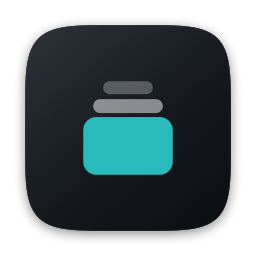
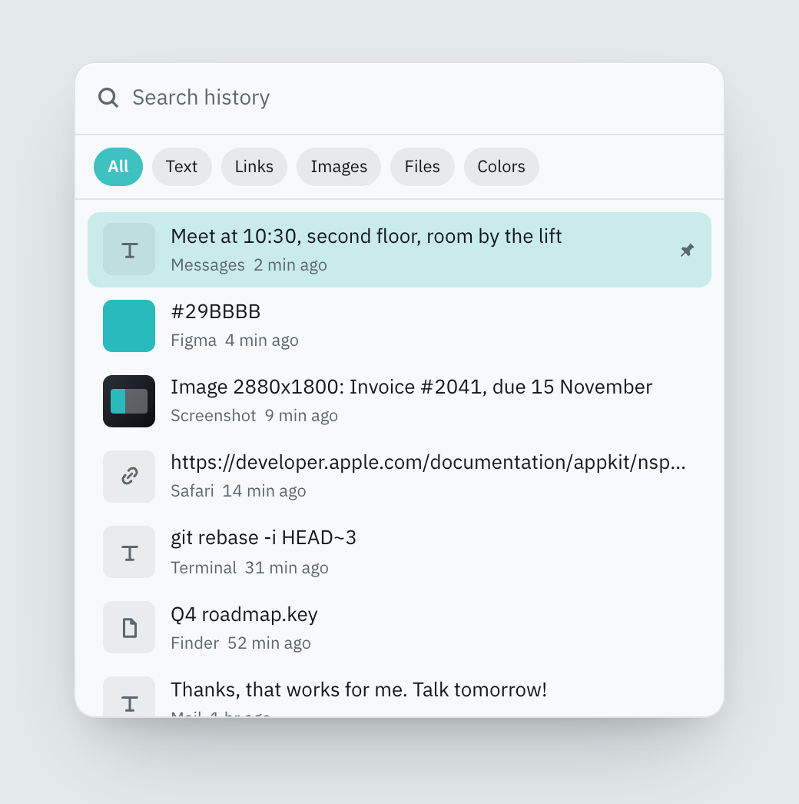

<p align="center">
  
</p>

<h1 align="center">Clipstack</h1>

<p align="center">
  <strong>Everything you copied, still there.</strong><br>
  Clipboard and screenshot history for the macOS menu bar.<br>
  No account. No network. No telemetry.
</p>

<p align="center">
  <a href="https://github.com/ricardus/clipstack/releases/latest">Download</a> &nbsp;|&nbsp;
  <a href="https://ricardus.github.io/clipstack/">Website</a> &nbsp;|&nbsp;
  <a href="#usage">Shortcuts</a>
</p>

<p align="center">
  
</p>

Press `Cmd+Shift+V` anywhere (or any shortcut you pick). Search what you copied,
step through text, links, images, files and colours with the arrow keys, and
paste it back into the app you were using. Screenshots land in the same list the
moment you take them, and you can find them later by the words in them.

- **Local by design.** History lives in `~/Library/Application Support/Clipstack`.
  The app makes no network requests.
- **Skips your secrets.** Password managers mark what they copy as concealed;
  Clipstack respects that and ignores 1Password, Bitwarden, Apple Passwords and
  friends entirely.
- **Searches inside screenshots.** Text in images is read on your Mac with
  Apple's Vision framework, so "invoice" finds the screenshot of one.
- **Native and small.** Swift and SwiftUI, zero dependencies, about 2,000 lines.

## Install

**Homebrew**

```bash
brew install ricardus/tap/clipstack
```

**Manual**: download the zip from the
[latest release](https://github.com/ricardus/clipstack/releases/latest), unzip
it and drag `Clipstack.app` into `/Applications`. Requires macOS 14 (Sonoma) or
later, on Apple Silicon or Intel.

### Opening it the first time

Clipstack is free and not notarized by Apple, so the first launch of a manual
download is blocked with a warning that Apple could not verify it. Either:

- open **System Settings > Privacy & Security**, scroll to the Clipstack
  message and click **Open Anyway**, or
- run `xattr -dr com.apple.quarantine /Applications/Clipstack.app`.

Homebrew does the second step for you. If you would rather not trust a binary,
[build it from source](#build-from-source): it takes about a minute.

### Permissions

1. **Accessibility** (System Settings > Privacy & Security > Accessibility).
   Needed to send `Cmd+V` to the app you were using. Without it, picking an
   entry still copies it; you paste by hand. Releases are signed with the same
   certificate every time, so the grant survives updates. (Coming from 1.0.0,
   which was signed ad hoc, macOS asks once more.)
2. **Desktop folder access**, the first time it reads the screenshot folder.
   Only needed for screenshot capture, which you can turn off in the menu.

## Usage

| Action | Shortcut |
|---|---|
| Open history | `Cmd+Shift+V`, or your own: menu bar > Change Shortcut… |
| Move selection | `↑` / `↓` |
| Previous / next type filter | `←` / `→` (while the search field is empty) |
| Paste selected | `Return` |
| Pin / unpin selected | `Cmd+P` |
| Delete selected | `Cmd+Delete` |
| Close | `Esc` |

Type to search. The chips filter by content type (`←` / `→` step through them,
wrapping from `Colors` back to all types; with text in the search field the
arrows move the caret instead), `Pin` narrows to pinned
entries, and the menu on the right filters by source app. `All` clears every
filter at once. Right-click an entry for pin, copy-without-pasting and delete.
Entries can be dragged out into other apps.

### Pinned entries

Pinned entries sort ahead of everything else and, whenever there are both kinds
on screen, appear under a `Pinned` header with a count, above a `Recent` header
for the rest. They carry a faint accent wash so the group reads as one block.
The `Pin` chip narrows the list to them alone; it is orthogonal to the type
chips, so "pinned images" is a valid combination.

The sections are ordinary headers inside the one scroll view, not a sticky
region: scroll far enough and the `Pinned` header scrolls away with the rest.
Making it stick would mean splitting the list into two scroll areas and picking
a maximum height for the pinned one.

### Capture feedback

Every capture shows a 28 px pill under the status item for 1.2 seconds, naming
what landed: `Text copied`, `Image 1280 × 800`, `3 files`, or the hex for a
colour. It is a borderless non-activating panel with `ignoresMouseEvents`, so it
never takes focus and never swallows a click. A second capture while one is
showing replaces the text in place instead of animating again.

It does not fire when you paste from the history: those writes are suppressed in
`ClipboardMonitor`, so no capture is recorded and nothing is announced.

## What it captures

Text, links, images, files and colors, tagged with the app they came from, plus
new screenshots appearing in the system screenshot folder (respects a custom
`defaults write com.apple.screencapture location`).

Images also go through on-device text recognition (Vision, `.accurate`, language
detected automatically), one at a time in the background. The text is stored in
the index next to the entry and searched like everything else; the row shows the
first line of it. Images captured before this existed are read on the next
launch. Turn it off with *Search Text in Images* in the menu bar.

## What it deliberately does not capture

- Anything marked `org.nspasteboard.ConcealedType`, `TransientType` or
  `AutoGeneratedType`. Password managers set these precisely so history apps
  skip them.
- Anything copied while an excluded app is frontmost. The default exclusion list
  covers 1Password, Bitwarden, LastPass, Dashlane, Enpass, Keychain Access and
  Apple Passwords. Edit it with:

  ```bash
  defaults write io.github.ricardus.clipstack excludedBundleIDs -array \
      com.1password.1password com.apple.Passwords com.example.other
  ```

Both mechanisms are best-effort. A clipboard history is an inherently sensitive
store: the index and image blobs sit unencrypted in your Application Support
folder, protected only by FileVault and your account. Do not treat it as a
vault.

## Accent colour

The panel and the toast use `Theme.accent` (`#29BBBB`, the accent from the
mark), not the system accent colour. Point `Theme.accent` back at
`.accentColor` in `Theme.swift` to follow the system setting instead.

## Settings

Stored in `UserDefaults` under `io.github.ricardus.clipstack`:

| Key | Default | Meaning |
|---|---|---|
| `historyLimit` | 500 | Max unpinned entries before the oldest are dropped |
| `watchScreenshots` | true | Watch the screenshot folder |
| `excludedBundleIDs` | see above | Apps never recorded |
| `recognizeText` | true | Read the text in images so search finds it |
| `hotKeyCode`, `hotKeyModifiers` | `V`, Cmd+Shift | The global shortcut, as a Carbon key code and modifier mask. Set it from the menu instead |

## Layout

```
Sources/Clipstack/
  Entry.swift            @main entry point, NSApplication bootstrap
  AppDelegate.swift      Wiring, menu bar item, global hotkey
  ClipItem.swift         History entry model and content hashing
  ClipStore.swift        JSON index + image blobs on disk, dedup, trimming
  ClipboardMonitor.swift changeCount polling and content typing
  ScreenshotWatcher.swift DispatchSource watch on the screenshot folder
  HotKey.swift           Carbon RegisterEventHotKey wrapper
  Shortcut.swift         Key code + modifiers, and their ⇧⌘V label
  ShortcutRecorder.swift The Change Shortcut window
  TextRecognizer.swift   On-device OCR with Vision
  Paster.swift           Pasteboard writes and synthesised Cmd+V
  PanelController.swift  Floating panel, focus handling, key handling
  AppState.swift         Search, filters, keyboard selection
  HistoryView.swift      SwiftUI panel content
  ClipRowView.swift      Single row
  Preferences.swift      UserDefaults wrapper
  StatusItemIcon.swift   Menu bar mark, drawn at runtime as a template image
  CaptureToast.swift     The pill shown under the status item after a capture
  Theme.swift            Brand colours

Tools/
  MakeIcons.swift        Renders Clipstack.iconset for iconutil (build-time only)
```

## Icon

The mark is three stacked cards on a dark squircle; the accent is
`oklch(0.72 0.115 195)` = `#29BBBB`.

- **App icon**: `build.sh` runs `swift Tools/MakeIcons.swift` once, pipes the
  iconset through `iconutil`, and caches `dist/Clipstack.icns`. Delete that file
  to redraw it after changing the geometry or colours.
- **Menu bar icon**: drawn at runtime by `StatusItemIcon`, as a template image
  so macOS recolours it for the current theme and inverts it while the menu is
  open. No PNG assets, crisp at any scale factor.

Both read the same 24x24 grid, so a change to the card rectangles has to be made
in `Tools/MakeIcons.swift` and `Sources/Clipstack/StatusItemIcon.swift` together.
The two differ only in fill: colour tiers in the app icon, alpha tiers in the
template.

## Build from source

Needs macOS 14 and the Xcode Command Line Tools (`xcode-select --install`).

```bash
git clone https://github.com/ricardus/clipstack.git
cd clipstack
./build.sh --install     # builds, copies to /Applications, launches
```

`./build.sh` alone leaves the app in `dist/Clipstack.app`. You can open
`Package.swift` in Xcode for completion, but use `build.sh` to produce the
runnable `.app`: a bare SwiftPM executable has no bundle, so `LSUIElement`, the
menu bar item and the login item would not work.

Ad-hoc signing changes the code identity on every build, so macOS forgets the
Accessibility grant. To keep it, create a self-signed certificate once
(Keychain Access, Certificate Assistant, Create a Certificate, name it
`Clipstack Local`, type *Code Signing*) and build with:

```bash
export CLIPSTACK_SIGN_IDENTITY="Clipstack Local"
./build.sh --install
```

`CLIPSTACK_UNIVERSAL=1 ./build.sh` builds one binary for Apple Silicon and Intel.

Releases are built by `.github/workflows/release.yml` on every `v*` tag:
universal, and signed with a self-signed `Clipstack Release` certificate kept in
the repository secrets `CLIPSTACK_CERT_P12` and `CLIPSTACK_CERT_PASSWORD`. That
certificate buys no Gatekeeper trust, only a code identity that stays the same
between releases. A fork without those secrets builds ad hoc.

## Known rough edges

- `Cmd+Shift+V` is also "paste without formatting" in Chrome, Slack and Google
  Docs, and a global shortcut wins over all of them. Change it from the menu bar
  if you use that. The recorder catches clashes with other global shortcuts, not
  with menu shortcuts inside apps.
- Opening the panel activates the app, so the previously frontmost app is
  captured on open and reactivated on paste. This is what Raycast and friends do
  too; a truly non-activating panel cannot host an editable search field.
- No custom categories and no iCloud sync, on purpose: pins cover the first, and
  the second would break the no-network promise.
- Not notarized, so the first launch of a manual download needs *Open Anyway*.

## License

MIT. See [LICENSE](LICENSE).
